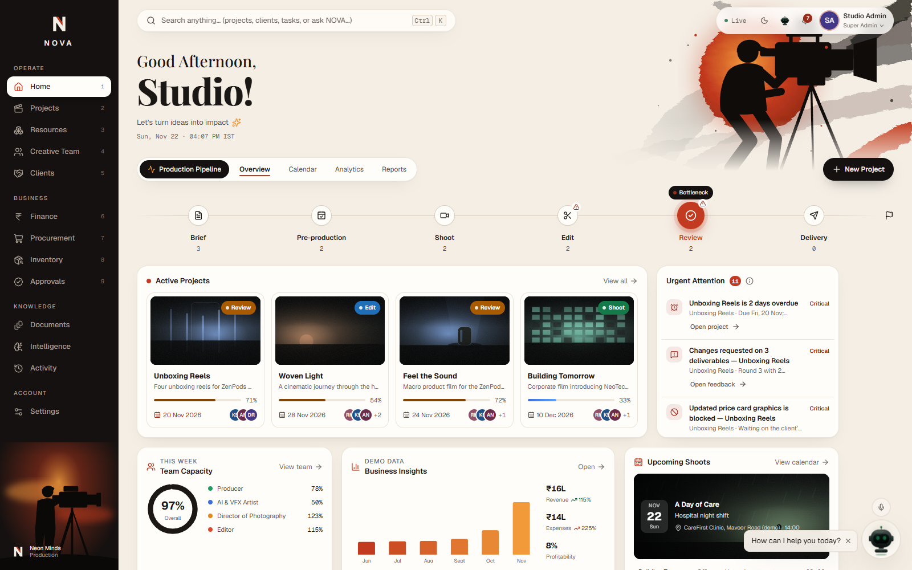
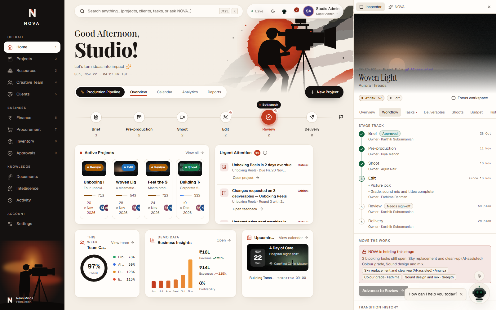
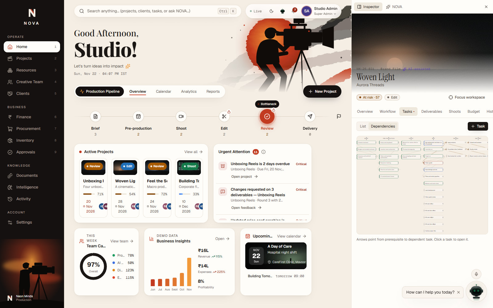
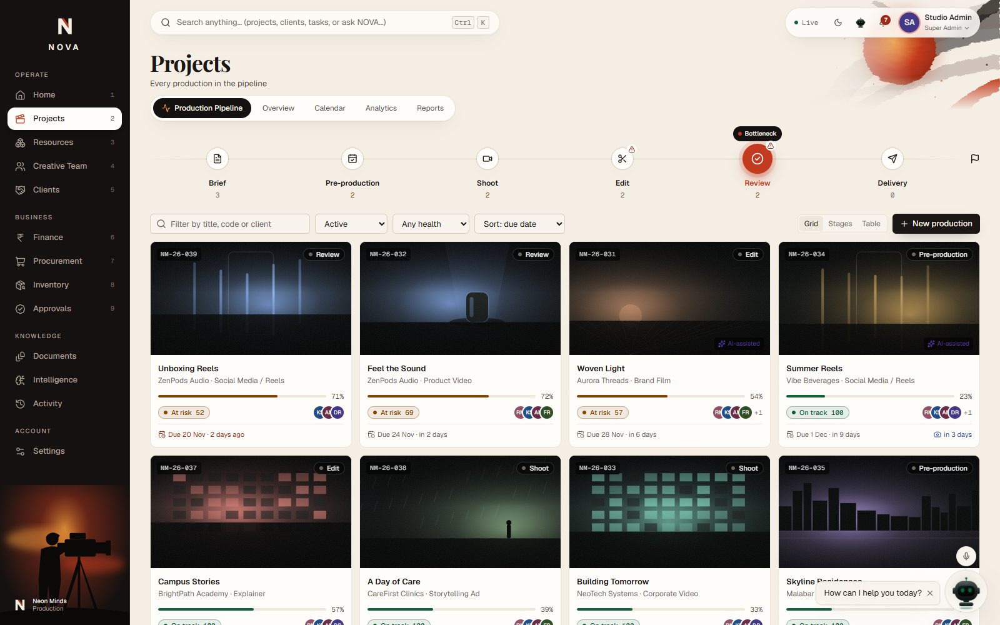
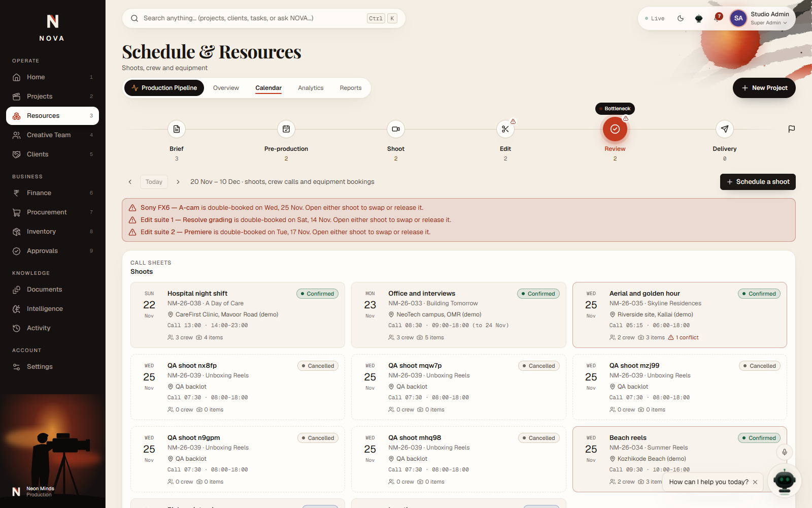
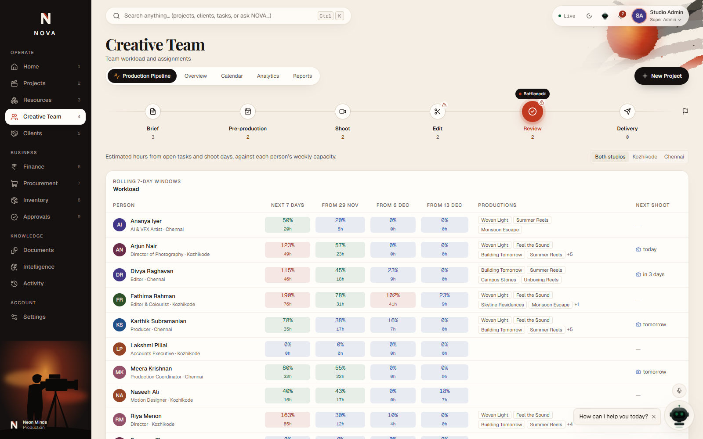
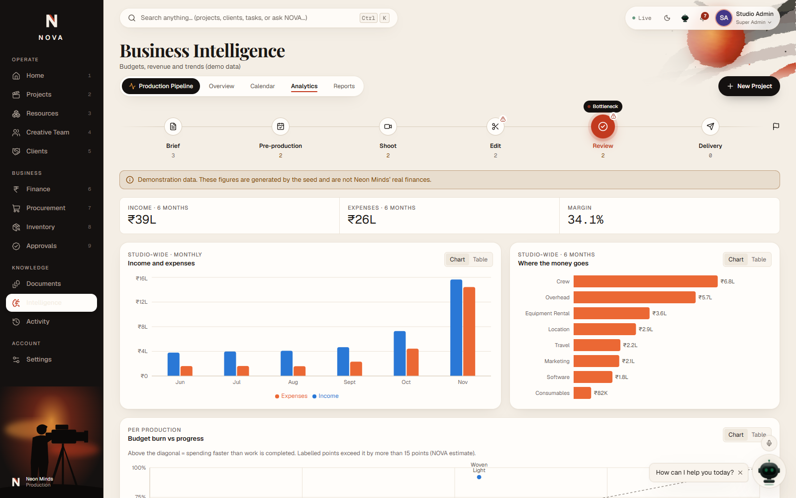
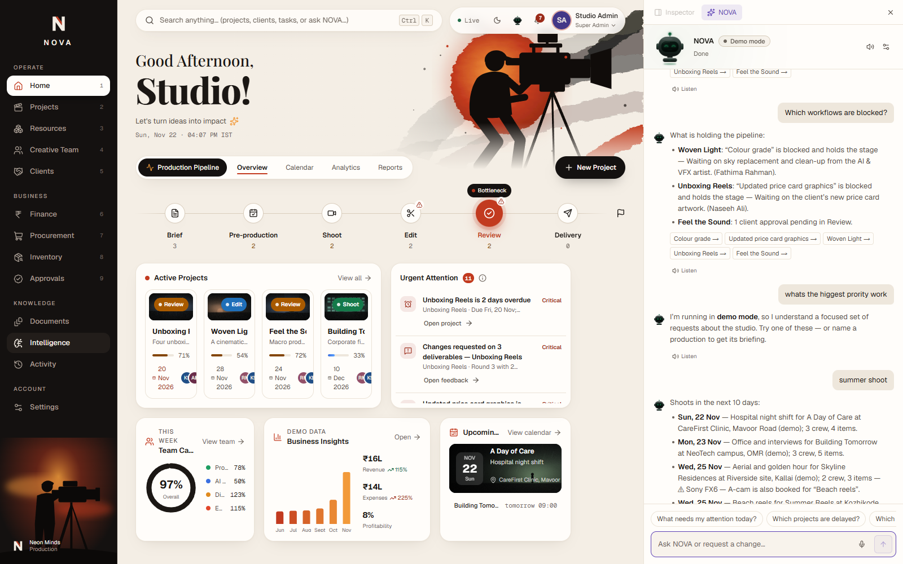
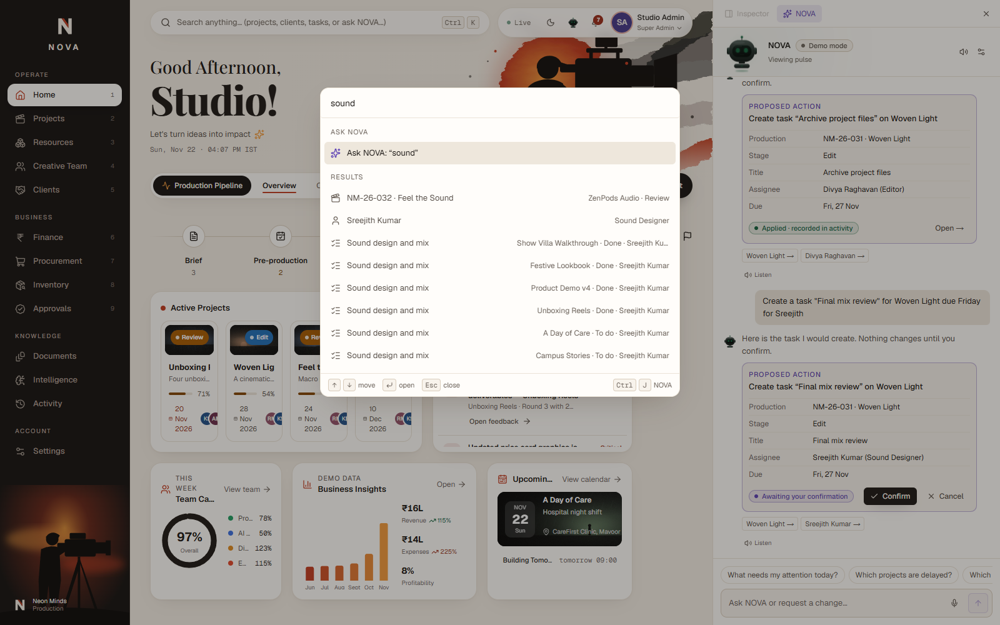
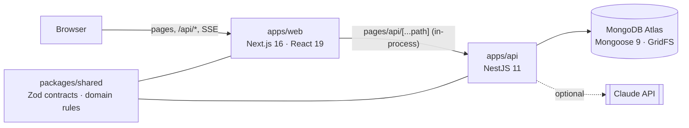

# NOVA — The Intelligent Business Operating System

**One connected workspace for a cinematic production studio.** NOVA runs the whole company — sales, the production pipeline from brief to delivery, crew and equipment, client approvals and the business behind it — in a single interface, with an AI assistant that answers from live data and changes nothing until you confirm.

Built as an interview prototype for [Neon Minds](https://www.neonmindsproduction.com/), a media production studio in Kozhikode and Chennai (product videos, brand films, storytelling ads, corporate videos, social reels). **All operational data is clearly labelled demonstration data** — see [Data policy](#data-policy).



---

## Why it's different

Most ERPs are a menu of department dashboards. NOVA is organised around the one thing every part of a studio shares: **the production lifecycle**.

| Idea                              | What you see                                                                                                                                                                                                     |
| --------------------------------- | ---------------------------------------------------------------------------------------------------------------------------------------------------------------------------------------------------------------- |
| **One workspace, many lenses**    | A single route (`/studio`). Pulse, Productions, Schedule, People, Clients & Sales, Business and Activity are arrangements of the same data — not separate apps.                                                  |
| **The Pipeline Spine**            | Brief → Pre-production → Shoot → Edit → Review → Delivery, always visible, with work in progress, blockers, risk, dwell time against plan, and the **current bottleneck** (Theory of Constraints).               |
| **Workspace focus**               | Click a stage, client, project or person and _every_ lens narrows to it — coordinated views, not filters per page. Stored in the URL, so any view is linkable.                                                   |
| **Explainable attention**         | A ranked queue of decisions (overdue work, ageing approvals, blocked tasks, double-booked gear, overloaded crew, budget burn). Each item states its rule and numbers and offers the one action that resolves it. |
| **A workflow engine you can see** | Guarded stage transitions name exactly what blocks them; dependencies form a graph; every move, send-back and skip is in the history.                                                                            |
| **Confirm-before-write AI**       | NOVA answers from the same tools as the UI. When you ask for a change, it shows a before/after proposal; only _Confirm_ applies it — through the same services, permissions and audit trail as a human.          |

## Tour

|                                                                                                                                                                                           |                                                                                                                                                          |
| ----------------------------------------------------------------------------------------------------------------------------------------------------------------------------------------- | -------------------------------------------------------------------------------------------------------------------------------------------------------- |
|  **Project inspector** — stage track, exit criteria, blockers, sign-off, history |  **Dependencies** — prerequisite graph, open edges animated                            |
|  **Productions** — visual cards, stage board, sortable table                                             |  **Schedule** — call sheets, equipment availability, double-bookings |
|  **People** — four rolling weeks of load against capacity                                                                       |  **Business** — income vs expenses, cost mix, budget burn vs progress (demo data)               |
|  **NOVA** — a proposed task, waiting for confirmation                                                        |  **Command palette** — search everything, jump, ask NOVA                                      |

Light ("daylight review") theme: [screenshot](docs/screenshots/10-light-theme.png) · Sign-in: [screenshot](docs/screenshots/00-login.png)

Production stills are **graded frames**: deterministic SVG compositions per project type in the client's colour, so cards are visual without stock photography or fake footage. Real stills can be attached via `coverImageUrl`.

## Features

- **Pulse** — headline instruments, ranked attention queue, 14-day call sheet, live activity, production previews.
- **Productions** — grid / stage board / table; search, filter by status and health, sort; create productions on any workflow template.
- **Workflow engine** — templates with planned days, approval gates and skippable stages; forward moves guarded by blocking tasks and sign-offs; send-back with a reason; skip; full transition history.
- **Tasks** — create, edit, assign, status, priorities, due dates, estimates; prerequisites with cycle detection; starting work with open prerequisites is refused.
- **Review loop** — send versions for client review (revision rounds beyond the contract are flagged), timecoded feedback, approve / request changes, stage sign-off.
- **Schedule** — shoots with crew calls and equipment; equipment availability grid; conflicts detected for gear and people, refused unless explicitly acknowledged; maintenance status.
- **People** — utilisation over four rolling weeks from task estimates and shoot days; open tasks and upcoming shoots per person.
- **Clients & Sales** — client directory, relationship value, pending approvals, communication log; lead pipeline from inquiry to won/lost.
- **Business** — six-month income and expenses, cost mix, budget burn vs progress per production, each with a table view. _Demo data._
- **Activity** — append-only audit trail of every change, filterable by area and source (person, NOVA, system).
- **Real time** — Server-Sent Events push every change; open views refresh themselves.
- **Notifications, command palette (Ctrl/⌘K), keyboard lenses (1–9), dark and light themes, responsive down to phones.**

### Business operations (ERP)

The same workspace also runs the business around the productions. Each module is a lens or a panel in the one shell — not a separate dashboard — and every rule below is enforced by the API ([plan](docs/development/erp-expansion-plan.md)).

- **Approvals** — one inbox for expenses, purchase requests and leave. Rules (by subject and amount) build multi-step chains; nobody approves their own request or two steps of the same chain; rejections need a reason; requesters and approvers are notified ([ADR-0010](docs/decisions/0010-approval-engine.md)). Client sign-offs on deliverables are shown alongside, clearly separate.
- **Finance** — invoices with server-computed totals, sending, payments and part-payments, receivables ageing (overdue is computed, never stored), expenses from claim to payment, vendors. Every payment and paid expense posts exactly one ledger entry, so reports read one source ([ADR-0011](docs/decisions/0011-ledger-postings.md)). _Demo data; not an accounting or tax system._
- **Procurement** — purchase requests with quotations, approval, purchase orders (refused if above the approved amount), partial and full receipt into stock, and the vendor bill raised for approval.
- **Inventory** — consumable stock with an append-only movement ledger (issue, return, recount), reorder levels and low-stock notices; equipment condition, custody and maintenance history.
- **People** — departments, who is in today, self check-in, leave requests through approval. Approved leave blocks crew calls on those days. Restricted employee records are visible only with `hr:read`.
- **Studios** — studio spaces and bookings; an overlapping booking is refused (409), tentative holds can be confirmed or released.
- **Documents** — versioned files in private storage outside the web root, type checked against the file's bytes and extension, SHA-256 per version, downloads streamed only after a permission check; confidential, HR and finance documents are invisible without access ([ADR-0012](docs/decisions/0012-document-storage.md)).
- **CRM & projects** — multiple contacts per client, lead owner and follow-up dates, lead → client + project conversion, milestones (billing points), risk register, one-level subtasks.
- **Settings** — users, a role ↔ permission matrix, approval rules, your sessions, password and notification preferences. Nine seeded roles; roles are data, permissions are code ([ADR-0009](docs/decisions/0009-configurable-roles.md)).

### NOVA assistant

- Asks: _What needs my attention today? · Which projects are delayed? · Which workflows are blocked? · Show the workload of the team · Find projects approaching their deadline · Summarize the activity from this week · Woven Light_ (briefing).
- Changes (always proposals): _Create a task "Final mix review" for Woven Light due Friday for Sreejith · Mark sky replacement on Woven Light as done · Reassign colour grade on Campus Stories to Divya · Advance Product Demo v4 · Log a call with ZenPods: marketing head reviewing v2 tomorrow._
- Context-aware: "this project" means the one open in the inspector or in focus.
- Proposals go **stale** if their target changed before confirmation; blocked stage moves are explained instead of proposed.
- **Two providers, one tool set** ([ADR-0005](docs/decisions/0005-assistant-provider-and-confirmation.md)):
  - **Demo mode** (default): deterministic intent rules and entity matching over live data — works offline, labelled in the UI.
  - **Claude**: set `ANTHROPIC_API_KEY` and NOVA uses `claude-opus-5-5` (override with `ASSISTANT_MODEL`) with tool use, adaptive thinking and server-side refusal fallbacks. If Claude is unreachable, it answers in demo mode and says so.
- **Robotic companion**: NOVA has its own animated robot figure (SVG, no 3D runtime). It shows six real states: idle, listening (driven by the microphone level), thinking, speaking (driven by speech progress), success and error. It is docked in the panel and floats in the corner while the panel is minimised, with a microphone, reply previews and Stop.
- **Multilingual** ([ADR-0013](docs/decisions/0013-nova-voice-and-multilingual.md)): with Claude, NOVA replies in the language you use (Malayalam, Hindi, Tamil, Telugu, Kannada, Bengali, Arabic, Urdu, French, German, Spanish and more), including mixed and transliterated messages, and follows a change of language mid-conversation. Right-to-left replies render right to left. Demo mode answers in English only and says so when you write in another language.
- **Voice conversation**: speak naturally and hear replies in the reply's language, using the best installed voice for it. Pause, resume and stop playback; interrupt NOVA by pressing the microphone, typing or pressing Esc. Hands-free mode listens again after each spoken answer. If no voice is installed for a language, NOVA says so and keeps the reply as text. Voice uses the browser's Web Speech API behind swappable interfaces. Recognition listens in one chosen language at a time; "Auto" follows the conversation. Browsers without speech recognition show a disabled microphone with the reason.

## Architecture



- **One app, one origin**: the NestJS API runs inside the Next.js app (a catch-all `pages/api` route boots it once per server instance), so the product deploys as a single Vercel project, the session cookie is first-party and there is no CORS ([ADR-0014](docs/decisions/0014-mongodb-and-single-vercel-app.md)).
- **One source of rules**: workflow guards, health scoring, flow metrics, conflict detection and attention ranking are pure functions in `packages/shared`, unit-tested once and used by both API and UI ([ADR-0007](docs/decisions/0007-shared-zod-contracts.md)).
- **Audit by construction**: every state change writes its activity row in the same transaction, then publishes it over SSE ([ADR-0006](docs/decisions/0006-sse-for-realtime.md)).

| Layer   | Technology                                                                                                                                                                         |
| ------- | ---------------------------------------------------------------------------------------------------------------------------------------------------------------------------------- |
| Web     | Next.js 16 (App Router, Turbopack), React 19, TypeScript 6, Tailwind CSS 4, Radix UI, cmdk, TanStack Query, Zustand, Motion, Recharts, React Flow (@xyflow/react), React Hook Form |
| API     | NestJS 11, Zod validation, cookie sessions, RBAC guards, throttling, SSE, Anthropic SDK                                                                                            |
| Data    | MongoDB Atlas, Mongoose 9 (multi-document transactions, virtual-populate relations), GridFS for documents                                                                          |
| Tooling | pnpm workspaces, Turborepo, ESLint, Prettier, Vitest, Supertest, Playwright; deployed on Vercel                                                                                    |

More: [system architecture](docs/architecture/01-system-architecture.md) · [domain model & formulas](docs/architecture/02-domain-model.md) · [repository structure](docs/architecture/03-folder-structure.md) · [design system](docs/design/01-design-system.md) · [API reference](docs/api/README.md) · [decision records](docs/decisions/README.md)

## Repository structure

```
nova/
├── apps/
│   ├── web/          Next.js workspace — features/ (one folder per lens, inspector, assistant…), components/, lib/, store/, pages/api (serves the API)
│   └── api/          NestJS API — auth/, common/, config/, database/, modules/ (domain + assistant), test/
├── packages/
│   ├── shared/       Zod request schemas, response types, enums, pure domain rules (+ unit tests)
│   ├── db/           Mongoose models, connection & transaction helpers, GridFS storage, seed (demo studio), password hashing
│   └── config/       Shared tsconfig and ESLint presets
├── tests/e2e/        Playwright journeys (system Chrome) and screenshot capture
└── docs/             research · architecture · design · decisions · api · development · screenshots
```

## Getting started

**Prerequisites:** Node.js ≥ 24.7, pnpm 10, and a MongoDB Atlas cluster (the free M0 tier works). No local database install.

```bash
pnpm install
cp .env.example .env          # set DATABASE_URL / TEST_DATABASE_URL (Atlas) and SEED_ADMIN_* (12+ char password)

pnpm db:seed                  # creates collections + indexes, loads the demonstration studio (wipes existing data)

pnpm dev                      # Studio and API on :3100 (the API is served at /api by the web app)
```

Open <http://localhost:3100/studio> and sign in with the `SEED_ADMIN_*` credentials (Super Admin). The seed also prints one-time passwords for demo accounts, one per working role, so you can see role-based access: `producer@nova.local` (Production Manager), `finance@nova.local` (Finance), `hr@nova.local` (HR), `creative@nova.local` (Creative Team) and `viewer@nova.local` (Guest, read-only). Passwords change on every seed.

Any MongoDB 7+ **replica set** works too (transactions need one). To run the API on its own, start it with `pnpm --filter @nova/api start` (port `API_PORT`) and set `API_INTERNAL_URL` so the web app forwards `/api/*` to it.

**Deploying:** see [Deploying to Vercel](docs/deployment/vercel.md). Production variables are listed in [`.env.production.example`](.env.production.example).

### Environment

| Variable                                                     | Purpose                                                                  |
| ------------------------------------------------------------ | ------------------------------------------------------------------------ |
| `DATABASE_URL`, `TEST_DATABASE_URL`                          | MongoDB connection strings (development and integration-test databases)  |
| `WEB_ORIGIN`                                                 | Allowed origin(s) for state-changing requests (https only in production) |
| `API_INTERNAL_URL`, `API_PORT`                               | Optional: run the API as a separate server                               |
| `SESSION_TTL_HOURS`, `SESSION_IDLE_HOURS`                    | Absolute (7 days) and idle (8 hours) session limits                      |
| `SEED_ADMIN_EMAIL`, `SEED_ADMIN_PASSWORD`, `SEED_ADMIN_NAME` | Initial administrator — never committed                                  |
| `ANTHROPIC_API_KEY`, `ASSISTANT_MODEL`                       | Optional: enable the Claude provider                                     |

The API validates its environment at start-up and refuses to run with a helpful message if anything is missing.

### Scripts

| Command                                  | What it does                                                                                                                              |
| ---------------------------------------- | ----------------------------------------------------------------------------------------------------------------------------------------- |
| `pnpm dev`                               | Shared/db/API packages in watch mode, Next.js dev server serving the Studio and the API (restart it to load API changes)                  |
| `pnpm build`                             | Production build of every package and app                                                                                                 |
| `pnpm typecheck` / `pnpm lint`           | Across the monorepo (Turborepo-cached)                                                                                                    |
| `pnpm test`                              | Unit, component and API integration tests (needs the database running)                                                                    |
| `pnpm test:e2e`                          | Playwright journeys and accessibility audits against the running app on :3100 (re-seeds the dev database; `E2E_SKIP_SEED=1` to keep data) |
| `pnpm screenshots`                       | Regenerates `docs/screenshots`                                                                                                            |
| `pnpm db:setup` · `db:seed` · `db:reset` | Create collections and indexes · load (wipe + seed) the demo studio                                                                       |

## Testing

Verified on the final build:

| Suite                | Tool                             | Tests | Covers                                                                                                                                                                                                                         |
| -------------------- | -------------------------------- | ----- | ------------------------------------------------------------------------------------------------------------------------------------------------------------------------------------------------------------------------------ |
| Domain rules         | Vitest                           | 37    | Transition guards, progress, cycles, health scoring, conflicts, utilisation, flow & constraint, attention ranking, language parsing                                                                                            |
| API integration      | Vitest + Supertest, real MongoDB | 37    | Auth (cookies, hashing, expiry, idle, deactivation, CSRF, rate limit, audit), RBAC, validation and error envelope, workflow engine, dependencies, booking conflicts, review loop, assistant propose / confirm / cancel / stale |
| Web unit & component | Vitest + Testing Library         | 13    | URL state, workspace store, formatting, panel loading / error / empty states                                                                                                                                                   |
| End-to-end           | Playwright (system Chrome)       | 14    | Sign-in/out and route protection, the five demo journeys, command palette, business lens, phone layout, screenshot capture                                                                                                     |
| Accessibility        | axe-core via Playwright          | 13    | WCAG 2.1 A/AA on login, all seven lenses, inspector and palette, plus three lenses in the light theme — no serious or critical violations                                                                                      |

API integration tests run against the **compiled** API (`dist/`) on a separate test database (`TEST_DATABASE_URL`), so they exercise exactly what ships, including NestJS decorator metadata.

## Security

- Argon2id password hashing (Node's built-in `crypto.argon2`, OWASP parameters); generic login errors with timing equalisation; login rate limiting.
- Opaque 256-bit session tokens in HttpOnly, SameSite=Lax cookies (Secure in production); only SHA-256 hashes stored; idle and absolute expiry; server-side logout.
- Global session guard (routes opt _out_), permission guard per route, UI hides what a role cannot do but the API is the authority.
- `Origin` / `Sec-Fetch-Site` checks on state-changing requests; security headers (`X-Frame-Options`, `nosniff`, referrer and permissions policies).
- No secrets in source; `.env` is git-ignored; the seed refuses to run without explicit admin credentials.
- Assistant writes only through confirmed proposals, re-checked for permission and staleness at confirmation.

## Data policy

The Neon Minds website was used for the company's name, services, project-type vocabulary, locations and brand cues ([company analysis](docs/research/01-company-analysis.md)). The site does not publish a production process, team, clients or figures, so:

- every client, person, project, booking and amount in NOVA is **fictional demonstration data**, generated deterministically with dates relative to the day you seed;
- testimonial names from the website are **not** reused as clients;
- the Business lens and finance API are marked as demo data;
- health scores, projections and the bottleneck are **explainable heuristics** labelled "NOVA estimate", not predictions from a trained model.

## Limitations

Finance is a demonstration ledger, not an accounting system: no double entry, tax filing or payment reversal yet. Payroll is out of scope. Media review is text-based (no video player); clients do not log in (the studio records their decisions); live updates (SSE) reach clients connected to the same server instance — on Vercel other clients catch up when their stream reconnects; health and flow are computed in memory — fine for a studio's working set. Development notes, issues met during the build and planned improvements: [roadmap](docs/development/roadmap.md).

## Documentation

- Research: [company analysis](docs/research/01-company-analysis.md) · [problem space & concept](docs/research/02-problem-space-and-concept.md)
- Architecture: [system](docs/architecture/01-system-architecture.md) · [domain model](docs/architecture/02-domain-model.md) · [structure](docs/architecture/03-folder-structure.md)
- [Design system](docs/design/01-design-system.md) · [API reference](docs/api/README.md) · [Decision records](docs/decisions/README.md) · [Roadmap & issues](docs/development/roadmap.md)
