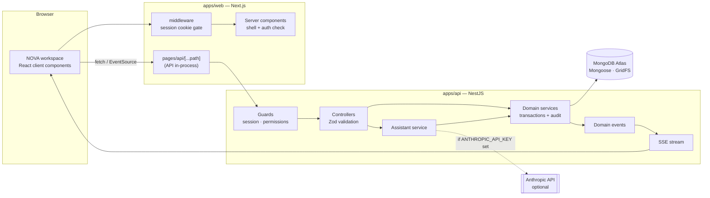
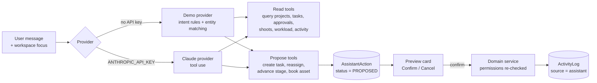

# 01 — System Architecture

## Overview



- **Same origin, one deployment.** The browser only talks to Next.js. A catch-all `pages/api` route hands `/api/*` to the NestJS application running in the same process (booted once per server instance), so the session cookie is first-party, `SameSite=Lax` works, no CORS configuration is needed, and the product deploys as one Vercel project (ADR-0014).
- **One source of business rules.** Pure domain rules (workflow transition guards, health score, conflict detection, attention ranking) live in `packages/shared`. The API enforces them; the UI reuses them for instant hints. They are unit-tested once.
- **Audit by construction.** Every state-changing service method writes its `ActivityLog` row in the same database transaction as the change.

## Backend (apps/api)

Layering inside every module:

```
Controller  — HTTP, auth decorators, Zod validation, DTO mapping
   ↓
Service     — use cases, permission-aware, MongoDB transaction, ActivityLog, emits domain event
   ↓
Mongoose    — data access (DatabaseService over the models in packages/db)
```

Modules:

| Module          | Responsibility                                                                      |
| --------------- | ----------------------------------------------------------------------------------- |
| `auth`          | Login, logout, session lookup, password hashing, `SessionGuard`, `PermissionsGuard` |
| `projects`      | Projects, budgets, cover previews, project timeline                                 |
| `workflow`      | Workflow templates and stage definitions, stage transitions, transition history     |
| `tasks`         | Tasks, task dependencies, assignment, status changes                                |
| `approvals`     | Deliverables, revision rounds, feedback items, approval decisions                   |
| `shoots`        | Shoot scheduling, crew call, equipment bookings                                     |
| `assets`        | Equipment register, availability, maintenance state                                 |
| `team`          | Team members, roles, capacity, workload                                             |
| `clients`       | Clients, interactions (calls, emails, meetings, feedback)                           |
| `sales`         | Leads and deal stages                                                               |
| `finance`       | Financial records (demo), budget-vs-actual                                          |
| `insights`      | Attention queue, health scores, flow metrics, analytics aggregates                  |
| `search`        | Cross-entity search for the command palette                                         |
| `activity`      | Audit trail queries                                                                 |
| `notifications` | Notifications generated from domain events                                          |
| `events`        | Server-Sent Events stream of domain events                                          |
| `assistant`     | NOVA AI: intent handling, action proposals, confirmation                            |

Cross-cutting (`src/common`): global exception filter (consistent error envelope), request logging interceptor with request IDs, Zod validation pipe, `@CurrentUser()` and `@RequirePermissions()` decorators, rate limiting on auth routes (`@nestjs/throttler`).

### REST surface (v1)

All routes are prefixed `/api/v1` and use one error envelope: `{ error: { code, message, details?, requestId } }`. The full, current endpoint reference — methods, permissions, request schemas and error codes — is in [`docs/api/README.md`](../api/README.md).

## Authentication and authorisation

```mermaid
sequenceDiagram
  participant B as Browser
  participant N as Next.js
  participant A as NestJS
  participant D as MongoDB
  B->>N: POST /api/v1/auth/login {email, password}
  N->>A: (in-process handler)
  A->>D: find user by email
  A->>A: verify Argon2id hash (constant-time)
  A->>D: insert Session {tokenHash = SHA-256(token), expiresAt}
  A-->>B: Set-Cookie nova_session=<random 256-bit token>; HttpOnly; SameSite=Lax; Secure in prod
  B->>N: GET /studio
  N->>N: middleware: cookie present? else redirect /login
  N->>A: server component calls /auth/me with cookie
  A->>D: lookup session by hash, check expiry + user active
  A-->>N: user + role + permissions
```

- **Passwords:** Argon2id via Node's built-in `crypto.argon2` (no native add-on; see ADR-0004).
- **Sessions:** opaque random tokens; only the SHA-256 hash is stored, so a database leak does not yield usable sessions. Idle timeout 8 h, absolute lifetime 7 days, rotation on login, deletion on logout.
- **CSRF:** `SameSite=Lax` cookie plus an `Origin` header check on all non-GET requests.
- **Brute force:** login limited per IP and per email; generic "invalid credentials" message.
- **Protection in depth:** Next middleware redirects unauthenticated users (fast path); the workspace layout verifies the session server-side; every API route is guarded by `SessionGuard` by default (public routes opt out explicitly).
- **RBAC:** `Role` ↔ `Permission` (many-to-many). Permissions are strings such as `project:write`, `workflow:transition`, `finance:read`. Seeded roles: `ADMIN` (all), `PRODUCER` (operations, no user admin), `VIEWER` (read-only). Controllers declare `@RequirePermissions(...)`. The UI hides or disables controls the user cannot use, but the API is the authority.
- **Credentials:** none in source. The seed reads `SEED_ADMIN_EMAIL` and `SEED_ADMIN_PASSWORD` from the environment and refuses to run without them.

## Frontend (apps/web)

- **Next.js App Router**, TypeScript strict.
- Routes: `/login` (public), `/studio` (the single workspace). `/` redirects based on session.
- **Server state:** TanStack Query, with query keys per resource and invalidation driven by SSE domain events, so other panels update when one panel changes data.
- **Workspace state:** a small Zustand store for lens, focus, inspector stack, assistant dock — synchronised with URL search params (`?lens=schedule&focus=client:abc&inspect=project:xyz`).
- **UI kit:** shadcn/ui components on Radix primitives (accessible dialogs, menus, popovers), `cmdk` for the palette, Tailwind CSS with design tokens as CSS variables, Framer Motion for restrained transitions (respecting `prefers-reduced-motion`).
- **Visualisation:** Recharts for time series and bars; `@xyflow/react` (React Flow) for the task dependency graph and the workflow template editor; the Pipeline Spine and schedule timeline are custom SVG/CSS components because they are the signature elements.
- **States:** every data panel has explicit loading (skeleton), empty (explanation + primary action) and error (message + retry) states through one shared `<PanelState>` pattern.
- **Feature folders:** each lens and each inspector is a feature folder that owns its components, hooks and queries. Shared primitives live in `components/`.

## NOVA assistant



- Both providers implement one `AssistantProvider` interface and share the same tools, so demo mode is a real local implementation over live data, not canned text.
- **Write tools only create proposals.** A proposal stores the exact payload and a human-readable diff. Confirmation calls the same domain service the UI uses, re-checking permissions and current state (a proposal goes stale if the target changed).
- The UI states which provider is active ("Demo mode — local intelligence" or "Claude").
- **Voice:** Web Speech API `SpeechRecognition` (Chromium browsers) for input and `speechSynthesis` for optional spoken replies. If unsupported, the microphone control is shown disabled with an explanation.
- `AssistantInteraction` rows keep the conversation history per user.

## Real-time

Server-Sent Events (`GET /api/v1/events`) push domain events (`task.updated`, `project.transitioned`, `approval.decided`, ...). The client maps events to query invalidations and to the live activity stream. SSE is one-directional, works through the in-process API route (up to the function's 300 s limit on Vercel; `EventSource` reconnects), needs no extra infrastructure, and is all NOVA needs — see ADR-0006.

## Configuration

| Variable                                  | Used by | Purpose                                                          |
| ----------------------------------------- | ------- | ---------------------------------------------------------------- |
| `DATABASE_URL`                            | api, db | MongoDB connection string (replica set, e.g. Atlas)              |
| `API_PORT`                                | api     | Port when the API runs standalone (default 4000)                 |
| `API_INTERNAL_URL`                        | web     | Optional: forward `/api/*` to a standalone API instead           |
| `WEB_ORIGIN`                              | api     | Allowed `Origin`(s) for state-changing requests, comma-separated |
| `SESSION_TTL_HOURS`, `SESSION_IDLE_HOURS` | api     | Session lifetime                                                 |
| `SEED_ADMIN_EMAIL`, `SEED_ADMIN_PASSWORD` | db seed | Initial admin (never committed)                                  |
| `ANTHROPIC_API_KEY`                       | api     | Optional; enables the Claude provider                            |
| `ASSISTANT_MODEL`                         | api     | Optional model override (default `claude-opus-5-5`)              |

Environment is validated with Zod at API start-up; the process exits with a clear message if something is missing.

## Testing strategy

| Level           | Tool                     | Scope                                                                                                |
| --------------- | ------------------------ | ---------------------------------------------------------------------------------------------------- |
| Unit            | Vitest                   | Domain rules in `packages/shared` (transition guards, health score, conflicts, attention ranking)    |
| API integration | Vitest + Supertest       | Each module against a real MongoDB test database: auth, guards, validation, transactions, audit rows |
| UI component    | Vitest + Testing Library | Inspector actions, palette, assistant proposal flow, panel states                                    |
| End-to-end      | Playwright               | Login/logout, protected route redirect, the five demo journeys, mobile viewport smoke test           |

## Explicit non-goals

Multi-tenancy, real media upload and playback, email/WhatsApp sending, payments and invoicing, and a native mobile app. Each is noted in the README's "Future improvements".
