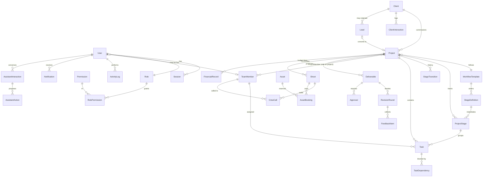
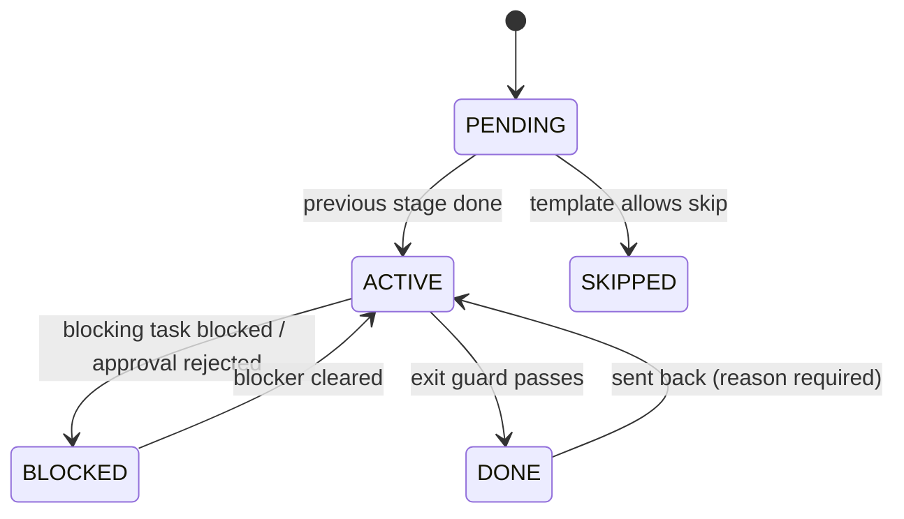

# 02 — Domain and Data Model

## Entity map

## Entities

### Identity and access

- **User** — admin/staff login: email (unique), passwordHash, name, avatarUrl, roleId, isActive, lastLoginAt.
- **Session** — tokenHash (unique), userId, expiresAt, lastSeenAt, ip, userAgent.
- **Role**, **Permission**, **RolePermission** — RBAC.

### People

- **TeamMember** — name, title (Director, DOP, Editor, Colourist, Motion Designer, Producer, Sound, Drone Operator…), skills[], baseLocation (`KOZHIKODE` | `CHENNAI`), weeklyCapacityHours, avatarUrl, optional userId.
- **ProjectMember** — role on a specific project (e.g. "Director on Aurora").

### Clients and sales

- **Client** — name, industry, city, status (`LEAD` | `ACTIVE` | `DORMANT`), primary contact (demo), accent colour for charts.
- **ClientInteraction** — type (`CALL` | `EMAIL` | `MEETING` | `WHATSAPP` | `FEEDBACK`), summary, occurredAt, loggedById, optional projectId.
- **Lead** — title, clientId or prospect name, projectType, estimatedValue, stage (`INQUIRY` | `DISCOVERY` | `PROPOSAL` | `NEGOTIATION` | `WON` | `LOST`), source (`WEBSITE` | `WHATSAPP` | `REFERRAL` | `INSTAGRAM` | `LINKEDIN`), expectedCloseDate, convertedProjectId.

### Production

- **Project** — code (e.g. `NM-25-014`), title, logline, clientId, type (`PRODUCT_VIDEO` | `BRAND_FILM` | `STORYTELLING_AD` | `CORPORATE_VIDEO` | `SOCIAL_REEL` | `PRODUCT_DEMO` | `EXPLAINER` | `EVENT_COVERAGE` | `AERIAL` | `MOTION_GRAPHICS` | `REAL_ESTATE` | `CAMPAIGN` | `STUDIO_GREEN_SCREEN` | `PODCAST`), workflowTemplateId, currentStageId, status (`ACTIVE` | `ON_HOLD` | `DELIVERED` | `CANCELLED`), priority, startDate, dueDate, budget, coverImageUrl, aiAssisted (bool — whether AI tools are part of the pipeline for this project).
- **WorkflowTemplate** — name (e.g. "Standard production", "Social sprint"), isDefault. Lets the studio define different lifecycles — a reel can skip parts of pre-production.
- **StageDefinition** — templateId, key (`BRIEF` | `PRE_PRODUCTION` | `SHOOT` | `EDIT` | `REVIEW` | `DELIVERY`), label, order, expectedDays, requiresApproval, exitCriteria (text list).
- **ProjectStage** — projectId, stageDefinitionId, status (`PENDING` | `ACTIVE` | `BLOCKED` | `DONE` | `SKIPPED`), ownerId, startedAt, completedAt.
- **StageTransition** — projectId, fromStageId, toStageId, direction (`FORWARD` | `BACKWARD`), reason, actorId, source (`UI` | `ASSISTANT` | `SEED`), createdAt. Workflow history.
- **Task** — projectId, projectStageId, title, description, assigneeId, status (`TODO` | `IN_PROGRESS` | `BLOCKED` | `IN_REVIEW` | `DONE`), priority (`LOW` | `MEDIUM` | `HIGH` | `URGENT`), dueDate, estimateHours, isStageBlocking, completedAt.
- **TaskDependency** — taskId, dependsOnTaskId (unique pair; cycles rejected).

### Deliverables and approvals

- **Deliverable** — projectId, name ("Master 16:9 4K", "Reel cut 9:16 30s"), format, aspectRatio, durationSec, status (`PLANNED` | `IN_PROGRESS` | `IN_REVIEW` | `CHANGES_REQUESTED` | `APPROVED` | `DELIVERED`), currentVersion, dueDate, previewImageUrl.
- **RevisionRound** — deliverableId, number, sentAt, closedAt, includedInScope (bool; rounds beyond the contracted number are flagged).
- **FeedbackItem** — revisionRoundId, timecode (`00:00:12:08`), body, author (client contact or member), status (`OPEN` | `RESOLVED`).
- **Approval** — deliverableId or projectStageId, kind (`INTERNAL` | `CLIENT`), status (`PENDING` | `APPROVED` | `CHANGES_REQUESTED`), requestedAt, decidedAt, decidedBy, note.

### Shoots and resources

- **Shoot** — projectId, title, location, city, startsAt, endsAt, callTime, status (`PLANNED` | `CONFIRMED` | `WRAPPED` | `CANCELLED`), notes.
- **CrewCall** — shootId, teamMemberId, role on shoot.
- **Asset** — name, category (`CAMERA` | `LENS` | `LIGHTING` | `AUDIO` | `GRIP` | `DRONE` | `STORAGE` | `COMPUTE`), serialTag, homeLocation, status (`AVAILABLE` | `MAINTENANCE` | `RETIRED`), dailyRate.
- **AssetBooking** — assetId, shootId (or projectId for post-production gear such as an edit suite), startsAt, endsAt. Availability is derived from bookings and status, not stored.

### Business (demo)

- **FinancialRecord** — projectId (optional), kind (`INCOME` | `EXPENSE`), category (`ADVANCE`, `MILESTONE`, `FINAL_PAYMENT`, `CREW`, `EQUIPMENT_RENTAL`, `LOCATION`, `TRAVEL`, `SOFTWARE`, `MARKETING`, `OVERHEAD`), amount (INR, integer paise), occurredOn, note, isDemo (always true in seed).

### System

- **ActivityLog** — actorId (nullable for system), source (`UI` | `ASSISTANT` | `SYSTEM`), action (`task.created`, `project.transitioned`…), entityType, entityId, summary (human-readable), metadata (JSON: before/after), createdAt. Append-only.
- **Notification** — userId, kind, title, body, entityType, entityId, readAt.
- **AssistantInteraction** — userId, role (`USER` | `ASSISTANT`), content, focusContext (JSON), provider, createdAt.
- **AssistantAction** — interactionId, kind, payload (JSON), preview (JSON diff), status (`PROPOSED` | `CONFIRMED` | `CANCELLED` | `FAILED` | `STALE`), resolvedAt, resultEntityId.

## Workflow rules

Stage lifecycle per project:

**Forward transition guard** (pure function in `packages/shared`, used by API and UI):

1. The target is the next non-skipped stage in the template.
2. No task in the current stage marked `isStageBlocking` is unfinished.
3. If the current stage `requiresApproval`, there is an `APPROVED` approval for it.
4. The user holds `workflow:transition`.

The guard returns either `ok` or a list of typed reasons (`OPEN_BLOCKING_TASKS`, `APPROVAL_MISSING`, …) with the offending entity IDs, so the UI can render "Blocked by: Colour grade (Editor, due Fri)" with links. Backward moves require a reason and are recorded as `BACKWARD`.

**Task dependencies:** a task cannot move to `IN_PROGRESS` while any task it depends on is unfinished; adding a dependency that creates a cycle is rejected (graph check on insert).

**Booking conflicts:** two bookings of the same asset, or two crew calls of the same member, with overlapping time ranges are conflicts. The API rejects them unless an explicit `allowOverlap` flag is sent (for example, a lens kit split across two units); the Schedule lens shows existing overlaps.

## Derived intelligence

All formulas are deterministic heuristics over current data and are labelled as such in the UI ("NOVA estimate"). They are not machine-learned predictions.

**Project health (0–100)**

- Start at 100.
- Overdue: −(15 + 5 per day late), capped at −45. A few hours late counts as one day.
- Schedule slip (only when not overdue): if the elapsed share of the schedule exceeds progress by more than 15 points, −(gap × 50), capped at −20.
- Blocked tasks: −8 each, capped at −24.
- Client approvals pending more than 2 days: −(6 + 2 per extra day) each; doubled when delivery is within 3 days; capped at −30.
- Budget burn (expenses ÷ budget) exceeding progress by more than 15 points: up to −20, proportional.
- Revision rounds beyond scope: −5 each.
- Bands: ≥ 75 _On track_, 50–74 _At risk_, < 50 _Critical_. Each deduction is returned as a reason so the score is explainable.

**Flow metrics per stage:** WIP (projects currently active in the stage), average dwell time (completed stage visits), throughput (exits per week over 4 weeks). **Constraint** = the stage whose queue would take longest to clear at its current pace (WIP ÷ throughput, in weeks); a stage holding work with no recent exits ranks highest.

**Utilisation per member:** four rolling 7-day windows starting today. (Estimated hours of open tasks due in the window — overdue work counts in the first window — plus 10 hours per shoot day on crew calls) ÷ weeklyCapacityHours. > 100 % overloaded, 85–100 % stretched, 40–85 % balanced, < 40 % available.

**Attention queue score:** severity weight × urgency (time to deadline or age of item) × impact (project priority, client value). Each item carries its rule, numbers and a suggested action.

**Delivery projection:** remaining expected stage days (from template, adjusted by the project's historical dwell ratio) added to today, compared with `dueDate`. Labelled "Projected — NOVA estimate".

## Seed data (demonstration)

Planned volume — enough to make every view meaningful, small enough to read:

| Entity            | Count                                    | Notes                                                                                                                        |
| ----------------- | ---------------------------------------- | ---------------------------------------------------------------------------------------------------------------------------- |
| Users             | 1 admin from env + 1 producer + 1 viewer | Demo passwords are generated on every seed and printed once                                                                  |
| Team members      | 10                                       | Split across Kozhikode and Chennai                                                                                           |
| Clients           | 8                                        | Fictional companies: D2C fashion, real estate, SaaS start-up, hospitality, education, consumer electronics, FMCG, healthcare |
| Projects          | 12                                       | Spread across all six stages; 3 at risk, 1 critical, 2 delivered                                                             |
| Tasks             | ~265                                     | Generated per stage from templates, sized by budget; dependencies and blocking flags                                         |
| Deliverables      | ~30                                      | Masters, cut-downs, reels; some in revision                                                                                  |
| Shoots            | 8                                        | Next 21 days, including one deliberate equipment conflict                                                                    |
| Assets            | 24                                       | Cameras, lenses, lights, audio, gimbal, drone, edit suites                                                                   |
| Leads             | 10                                       | Across all sales stages                                                                                                      |
| Financial records | ~120                                     | Six months of demo income and expenses                                                                                       |
| Activity          | ~150                                     | Back-filled history so streams and dwell times are realistic                                                                 |

Seed is deterministic (fixed random seed) and dates are relative to the day it runs, so the demo always looks current.
